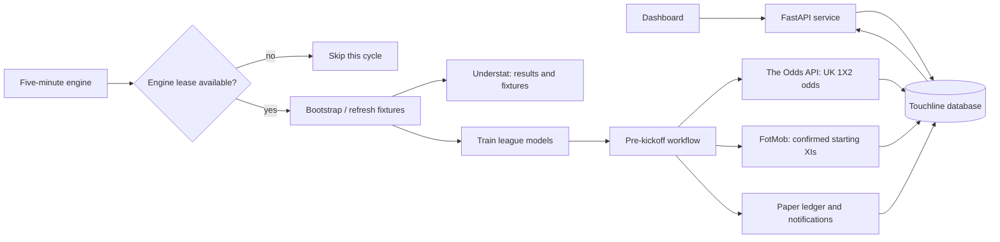
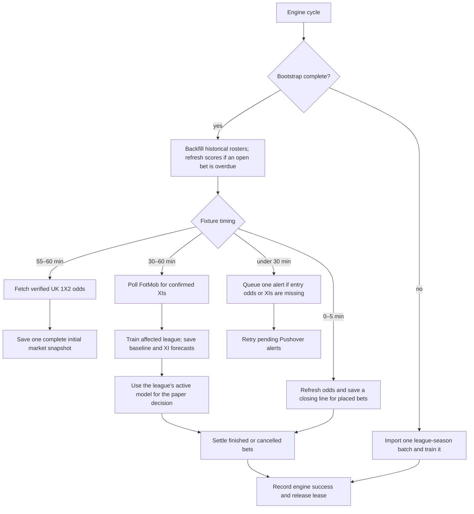
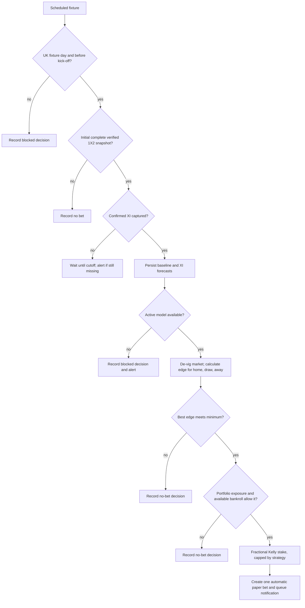

# Workflow and decision logic

Touchline is a paper-only system. The API serves the dashboard and records
state; the engine performs the scheduled data refresh, forecasting, paper-bet,
and settlement work. A shared portfolio starts at £1,000 across all five
supported leagues.

## System flow

Railway runs the API service and one engine worker. The engine takes a lease
before it runs, so overlapping scheduled or deployment-triggered cycles do not
create duplicate work. Fixture, forecast, quote, decision, bet, and alert
records are persisted in SQLite locally or PostgreSQL on Railway.

## Engine cycle

The initial bootstrap imports one competition-season batch per cycle until the
current and prior three seasons are present. After bootstrap, a cycle only
refreshes Understat scores when a bet is overdue or in play; roster backfill is
kept as a small separate batch. This bounds startup and keeps the public API
responsive.

For every scheduled fixture in the seven-day horizon, the engine uses these
pre-kickoff windows. Times are minutes before kick-off.

The first complete verified market captured at 55–60 minutes is the entry
market. XI retries do not refresh it, so a later confirmed lineup cannot alter
the recorded paper-bet price. A final market capture near kick-off is stored
only for closing-line-value reporting.

## Forecast and paper-bet decision

Each league has a time-decayed Dixon–Coles model trained from completed
Understat results. The baseline (`baseline-v1`) is the default. A
confirmed-XI model (`xi-v2`) uses the captured XI plus historical player data,
but remains a shadow forecast until an operator promotes it for that league
after its historical and live-observation requirements are met.

The selected outcome is the one with the highest model edge against the
de-vigged market. The engine never submits a bookmaker order. It records the
chosen price, implied market probability, model probability, edge, model
version, and staking inputs in the ledger. The configured strategy controls
minimum edge, maximum exposure, quote freshness, Kelly fraction, maximum bet
fraction, and minimum stake.

## Settlement and dashboard

When Understat confirms a final score, an open bet becomes won, lost, void, or
review (when a score remains incomplete). Settlement is idempotent and uses the
fixed entry snapshot, not the closing line. The dashboard reads the public API
for a shared bankroll/performance summary, selected-league forecasts and bets,
and all-league engine coverage. Its manual refresh endpoints run the same
engine helpers under separate leases; deployment refresh requires its shared
secret header and runs in the background.

## Operational guardrails

- Only the five defined competitions are accepted; unknown leagues return an
  API validation error.
- Provider fixtures are matched using canonical team identities and a bounded
  kickoff window. Ambiguous identities are quarantined rather than guessed.
- A complete market requires all three verified 1X2 outcomes from a bookmaker;
  stale quotes are excluded from decisions.
- Pushover delivery is retry-safe and cannot change whether a paper bet was
  recorded.
- The API health endpoint reports paper mode; engine health becomes unhealthy
  when no successful cycle has been recorded recently.
